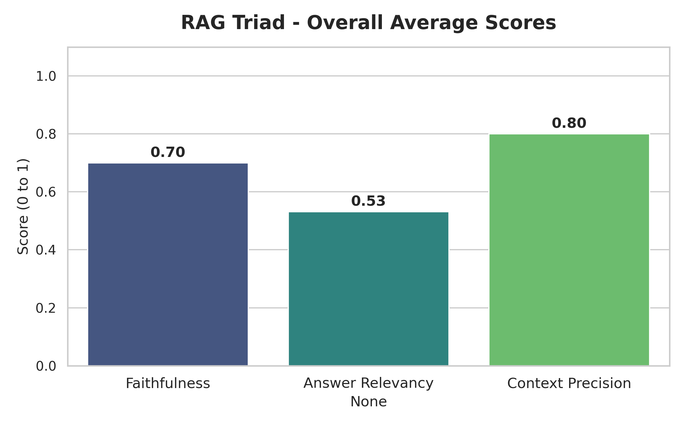
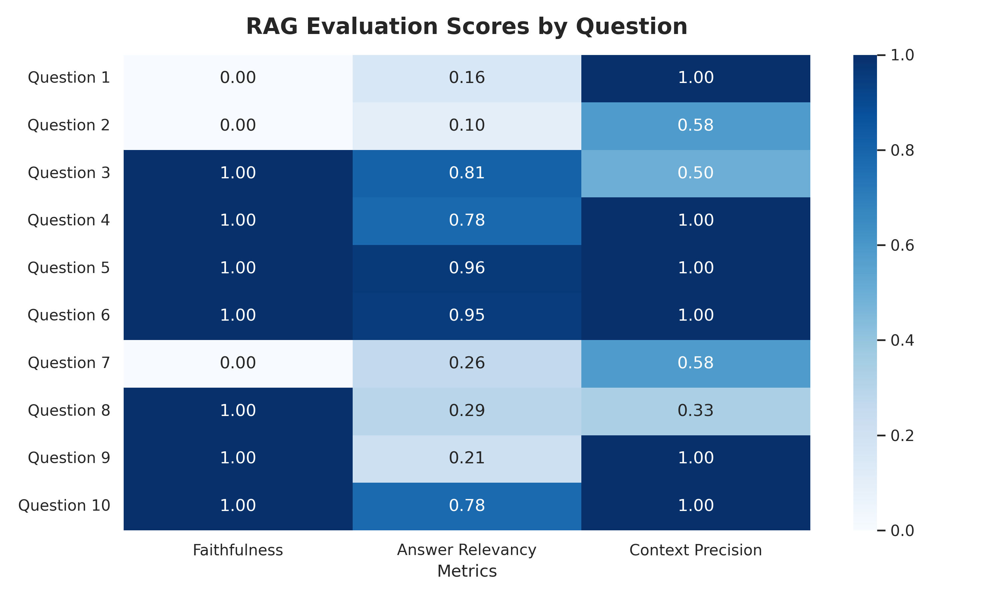

# Policy RAG with Automated Evaluation

A retrieval-augmented generation (RAG) assistant that answers questions from a corporate policy PDF, plus a pipeline that **measures** how well it does with [Ragas](https://github.com/explodinggradients/ragas) (LLM-as-a-judge).

The goal was a strict "policy librarian": answer only from the document, and say so when the answer is not there.

## Pipeline

| Step | Choice |
| :-- | :-- |
| Loading | `PyPDFLoader` |
| Chunking | `SemanticChunker` (splits by meaning, not by character count) |
| Embeddings | `all-MiniLM-L6-v2` (HuggingFace) |
| Vector store | Chroma (local) |
| Reranking | FlashRank via `ContextualCompressionRetriever` |
| Generator | Cohere `command-r-08-2024`, temperature 0, strict context-only prompt |
| Judge | Same Cohere model, through Ragas |

## Evaluation

A 10-question golden dataset, scored on three metrics:

| Metric | Average | What it says |
| :-- | :-: | :-- |
| Context precision | **0.80** | Retrieval + reranking usually brings the right policy section |
| Faithfulness | **0.70** | 7 of 10 answers are fully grounded; **3 of 10 scored 0** |
| Answer relevancy | **0.53** | Answers are short and literal, which this metric penalizes |

Per-question scores: [`results/rag_cohere_evaluation_results.csv`](results/rag_cohere_evaluation_results.csv)

**Honest reading:** the strict prompt reduces hallucination but does not eliminate it. The three zero-faithfulness answers still need manual review: Ragas also gives 0 to a refusal such as *"that information is not in the policy"*, so some of them may be refusals rather than invented facts. A 10-question set is also too small for strong conclusions.

## Engineering notes

- **Split-phase evaluation.** The free Cohere tier allows 5 requests per minute. Generation and judging run as separate phases and generations are cached, so the evaluation can be re-run without spending API calls again.
- **Dependency pinning.** `langchain-core` and the HuggingFace partner packages conflicted; pinning the `~=0.3.0` line fixed it.
- **Framework glue.** A small parser override lets Ragas accept Cohere's completion signals through the LangChain wrapper.

## Run it

1. Open `rag_policy_librarian.ipynb` (Google Colab or local Jupyter).
2. `pip install -r requirements.txt`
3. Provide your Cohere key when prompted (it is read with `getpass` into `CO_API_KEY`, never stored in the notebook).
4. Add a PDF as described in [`data/README.md`](data/README.md).

## Next steps

- Grow the golden set beyond 10 questions
- Separate refusals from real hallucinations before scoring faithfulness
- Use a different model as judge than as generator

## License

MIT
